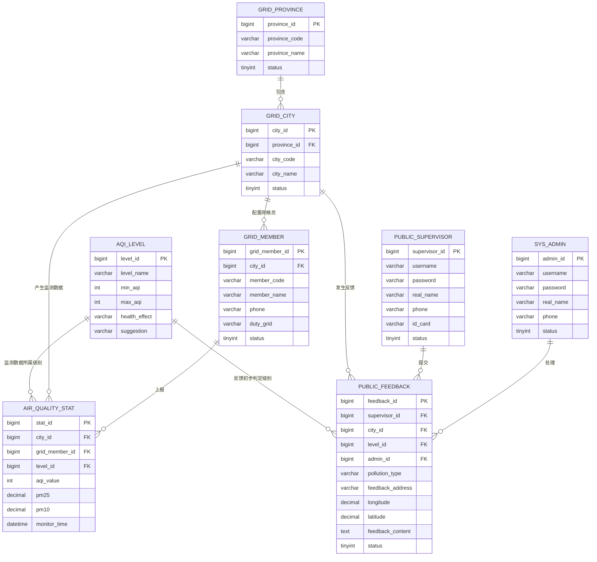

# 东软环保公众监督系统数据库设计文档

## 一、数据库设计说明

数据库名称：`neusoft_environment_supervision`

东软环保公众监督系统主要面向环保公众监督业务，系统数据库需要保存空气质量指数级别、空气质量监测网格员、系统覆盖省市区域、公众监督反馈、空气质量监测统计、系统管理员和公众监督员等数据。

本数据库设计文档包括：

| 序号 | 内容 |
| --- | --- |
| 1 | ER 图 |
| 2 | 数据库设计总表 |
| 3 | 空气质量指数级别表 |
| 4 | 空气质量监测网格员表 |
| 5 | 系统网格覆盖省区域表 |
| 6 | 系统网格覆盖市区域表 |
| 7 | 空气质量公众监督反馈表 |
| 8 | 空气质量监测数据统计表 |
| 9 | 系统管理员表 |
| 10 | 公众监督员表 |

## 二、ER 图

## 三、数据表详细设计

### 1. 数据库设计总表

| 序号 | 数据表名 | 中文表名 | 主键 | 说明 |
| --- | --- | --- | --- | --- |
| 1 | `aqi_level` | 空气质量指数级别表 | `level_id` | 维护 AQI 指数等级、指数范围、健康影响和防护建议 |
| 2 | `grid_member` | 空气质量监测网格员表 | `grid_member_id` | 维护空气质量监测网格员基础信息及所属城市网格 |
| 3 | `grid_province` | 系统网格覆盖省区域表 | `province_id` | 维护系统覆盖的省级区域信息 |
| 4 | `grid_city` | 系统网格覆盖市区域表 | `city_id` | 维护系统覆盖的市级区域信息，并关联省区域 |
| 5 | `public_feedback` | 空气质量公众监督反馈表 | `feedback_id` | 保存公众监督员提交的空气污染监督反馈 |
| 6 | `air_quality_stat` | 空气质量监测数据统计表 | `stat_id` | 保存网格员上报或系统采集的空气质量监测数据 |
| 7 | `sys_admin` | 系统管理员表 | `admin_id` | 保存后台系统管理员账号信息 |
| 8 | `public_supervisor` | 公众监督员表 | `supervisor_id` | 保存公众监督员注册、登录和认证信息 |

### 2. 空气质量指数级别表

表名：`aqi_level`

用途：保存空气质量指数级别标准，用于反馈记录和监测数据的级别判定。

| 序号 | 字段名 | 数据类型 | 长度 | 是否主键 | 是否为空 | 默认值 | 字段说明 |
| --- | --- | --- | --- | --- | --- | --- | --- |
| 1 | `level_id` | bigint | 20 | 是 | 否 | 自增 | 空气质量指数级别 ID |
| 2 | `level_name` | varchar | 20 | 否 | 否 | 无 | 级别名称，如优、良、轻度污染 |
| 3 | `min_aqi` | int | 11 | 否 | 否 | 无 | AQI 最小值 |
| 4 | `max_aqi` | int | 11 | 否 | 否 | 无 | AQI 最大值 |
| 5 | `health_effect` | varchar | 255 | 否 | 是 | NULL | 对人体健康影响 |
| 6 | `suggestion` | varchar | 255 | 否 | 是 | NULL | 出行或防护建议 |
| 7 | `create_time` | datetime | - | 否 | 否 | 当前时间 | 创建时间 |
| 8 | `update_time` | datetime | - | 否 | 是 | NULL | 更新时间 |

### 3. 空气质量监测网格员表

表名：`grid_member`

用途：保存空气质量监测网格员信息，记录其所属城市、责任网格和联系方式。

| 序号 | 字段名 | 数据类型 | 长度 | 是否主键 | 是否为空 | 默认值 | 字段说明 |
| --- | --- | --- | --- | --- | --- | --- | --- |
| 1 | `grid_member_id` | bigint | 20 | 是 | 否 | 自增 | 网格员 ID |
| 2 | `city_id` | bigint | 20 | 否 | 否 | 无 | 所属市区域 ID，关联 `grid_city.city_id` |
| 3 | `member_code` | varchar | 30 | 否 | 否 | 无 | 网格员工号 |
| 4 | `member_name` | varchar | 50 | 否 | 否 | 无 | 网格员姓名 |
| 5 | `gender` | tinyint | 1 | 否 | 是 | NULL | 性别：1 男，2 女 |
| 6 | `phone` | varchar | 20 | 否 | 否 | 无 | 联系电话 |
| 7 | `duty_grid` | varchar | 120 | 否 | 否 | 无 | 负责监测的网格区域 |
| 8 | `status` | tinyint | 1 | 否 | 否 | 1 | 状态：1 启用，0 禁用 |
| 9 | `create_time` | datetime | - | 否 | 否 | 当前时间 | 创建时间 |
| 10 | `update_time` | datetime | - | 否 | 是 | NULL | 更新时间 |

### 4. 系统网格覆盖省区域表

表名：`grid_province`

用途：保存系统网格覆盖的省级行政区域信息。

| 序号 | 字段名 | 数据类型 | 长度 | 是否主键 | 是否为空 | 默认值 | 字段说明 |
| --- | --- | --- | --- | --- | --- | --- | --- |
| 1 | `province_id` | bigint | 20 | 是 | 否 | 自增 | 省区域 ID |
| 2 | `province_code` | varchar | 20 | 否 | 否 | 无 | 省级行政区划编码 |
| 3 | `province_name` | varchar | 50 | 否 | 否 | 无 | 省名称 |
| 4 | `sort_no` | int | 11 | 否 | 是 | 0 | 排序号 |
| 5 | `status` | tinyint | 1 | 否 | 否 | 1 | 状态：1 启用，0 禁用 |
| 6 | `create_time` | datetime | - | 否 | 否 | 当前时间 | 创建时间 |
| 7 | `update_time` | datetime | - | 否 | 是 | NULL | 更新时间 |

### 5. 系统网格覆盖市区域表

表名：`grid_city`

用途：保存系统网格覆盖的市级行政区域信息，并与省级区域建立关联关系。

| 序号 | 字段名 | 数据类型 | 长度 | 是否主键 | 是否为空 | 默认值 | 字段说明 |
| --- | --- | --- | --- | --- | --- | --- | --- |
| 1 | `city_id` | bigint | 20 | 是 | 否 | 自增 | 市区域 ID |
| 2 | `province_id` | bigint | 20 | 否 | 否 | 无 | 所属省区域 ID，关联 `grid_province.province_id` |
| 3 | `city_code` | varchar | 20 | 否 | 否 | 无 | 市级行政区划编码 |
| 4 | `city_name` | varchar | 50 | 否 | 否 | 无 | 市名称 |
| 5 | `sort_no` | int | 11 | 否 | 是 | 0 | 排序号 |
| 6 | `status` | tinyint | 1 | 否 | 否 | 1 | 状态：1 启用，0 禁用 |
| 7 | `create_time` | datetime | - | 否 | 否 | 当前时间 | 创建时间 |
| 8 | `update_time` | datetime | - | 否 | 是 | NULL | 更新时间 |

### 6. 空气质量公众监督反馈表

表名：`public_feedback`

用途：保存公众监督员提交的空气质量问题反馈，包括污染类型、位置、现场描述、处理状态等。

| 序号 | 字段名 | 数据类型 | 长度 | 是否主键 | 是否为空 | 默认值 | 字段说明 |
| --- | --- | --- | --- | --- | --- | --- | --- |
| 1 | `feedback_id` | bigint | 20 | 是 | 否 | 自增 | 公众监督反馈 ID |
| 2 | `supervisor_id` | bigint | 20 | 否 | 否 | 无 | 公众监督员 ID，关联 `public_supervisor.supervisor_id` |
| 3 | `city_id` | bigint | 20 | 否 | 否 | 无 | 反馈所在市区域 ID，关联 `grid_city.city_id` |
| 4 | `level_id` | bigint | 20 | 否 | 是 | NULL | 初步空气质量级别 ID，关联 `aqi_level.level_id` |
| 5 | `admin_id` | bigint | 20 | 否 | 是 | NULL | 处理管理员 ID，关联 `sys_admin.admin_id` |
| 6 | `pollution_type` | varchar | 30 | 否 | 否 | 无 | 污染类型，如扬尘、异味、烟尘、废气 |
| 7 | `feedback_address` | varchar | 200 | 否 | 否 | 无 | 反馈问题详细地址 |
| 8 | `longitude` | decimal | 10,6 | 否 | 是 | NULL | 经度 |
| 9 | `latitude` | decimal | 10,6 | 否 | 是 | NULL | 纬度 |
| 10 | `feedback_content` | text | - | 否 | 否 | 无 | 反馈内容描述 |
| 11 | `image_url` | varchar | 255 | 否 | 是 | NULL | 现场图片地址 |
| 12 | `status` | tinyint | 1 | 否 | 否 | 0 | 处理状态：0 待处理，1 处理中，2 已处理，3 已驳回 |
| 13 | `reply_content` | varchar | 500 | 否 | 是 | NULL | 管理员处理回复 |
| 14 | `submit_time` | datetime | - | 否 | 否 | 当前时间 | 提交时间 |
| 15 | `handle_time` | datetime | - | 否 | 是 | NULL | 处理时间 |

### 7. 空气质量监测数据统计表

表名：`air_quality_stat`

用途：保存空气质量监测数据统计信息，包括 AQI、PM2.5、PM10、SO2、NO2、CO、O3 等指标。

| 序号 | 字段名 | 数据类型 | 长度 | 是否主键 | 是否为空 | 默认值 | 字段说明 |
| --- | --- | --- | --- | --- | --- | --- | --- |
| 1 | `stat_id` | bigint | 20 | 是 | 否 | 自增 | 监测统计 ID |
| 2 | `city_id` | bigint | 20 | 否 | 否 | 无 | 市区域 ID，关联 `grid_city.city_id` |
| 3 | `grid_member_id` | bigint | 20 | 否 | 否 | 无 | 上报网格员 ID，关联 `grid_member.grid_member_id` |
| 4 | `level_id` | bigint | 20 | 否 | 否 | 无 | 空气质量指数级别 ID，关联 `aqi_level.level_id` |
| 5 | `aqi_value` | int | 11 | 否 | 否 | 无 | AQI 指数值 |
| 6 | `pm25` | decimal | 8,2 | 否 | 是 | NULL | PM2.5 浓度 |
| 7 | `pm10` | decimal | 8,2 | 否 | 是 | NULL | PM10 浓度 |
| 8 | `so2` | decimal | 8,2 | 否 | 是 | NULL | 二氧化硫浓度 |
| 9 | `no2` | decimal | 8,2 | 否 | 是 | NULL | 二氧化氮浓度 |
| 10 | `co` | decimal | 8,2 | 否 | 是 | NULL | 一氧化碳浓度 |
| 11 | `o3` | decimal | 8,2 | 否 | 是 | NULL | 臭氧浓度 |
| 12 | `monitor_time` | datetime | - | 否 | 否 | 无 | 监测时间 |
| 13 | `create_time` | datetime | - | 否 | 否 | 当前时间 | 创建时间 |

### 8. 系统管理员表

表名：`sys_admin`

用途：保存系统后台管理员信息，用于后台登录、反馈处理和系统管理。

| 序号 | 字段名 | 数据类型 | 长度 | 是否主键 | 是否为空 | 默认值 | 字段说明 |
| --- | --- | --- | --- | --- | --- | --- | --- |
| 1 | `admin_id` | bigint | 20 | 是 | 否 | 自增 | 系统管理员 ID |
| 2 | `username` | varchar | 50 | 否 | 否 | 无 | 管理员登录账号 |
| 3 | `password` | varchar | 100 | 否 | 否 | 无 | 登录密码，实际项目应加密存储 |
| 4 | `real_name` | varchar | 50 | 否 | 否 | 无 | 管理员姓名 |
| 5 | `phone` | varchar | 20 | 否 | 是 | NULL | 联系电话 |
| 6 | `role_name` | varchar | 30 | 否 | 是 | 系统管理员 | 角色名称 |
| 7 | `status` | tinyint | 1 | 否 | 否 | 1 | 状态：1 启用，0 禁用 |
| 8 | `last_login_time` | datetime | - | 否 | 是 | NULL | 最后登录时间 |
| 9 | `create_time` | datetime | - | 否 | 否 | 当前时间 | 创建时间 |
| 10 | `update_time` | datetime | - | 否 | 是 | NULL | 更新时间 |

### 9. 公众监督员表

表名：`public_supervisor`

用途：保存公众监督员账号信息，用于公众监督员登录和提交空气质量监督反馈。

| 序号 | 字段名 | 数据类型 | 长度 | 是否主键 | 是否为空 | 默认值 | 字段说明 |
| --- | --- | --- | --- | --- | --- | --- | --- |
| 1 | `supervisor_id` | bigint | 20 | 是 | 否 | 自增 | 公众监督员 ID |
| 2 | `username` | varchar | 50 | 否 | 否 | 无 | 公众监督员登录账号 |
| 3 | `password` | varchar | 100 | 否 | 否 | 无 | 登录密码，实际项目应加密存储 |
| 4 | `real_name` | varchar | 50 | 否 | 否 | 无 | 真实姓名 |
| 5 | `phone` | varchar | 20 | 否 | 否 | 无 | 手机号 |
| 6 | `id_card` | varchar | 30 | 否 | 是 | NULL | 身份证号 |
| 7 | `email` | varchar | 80 | 否 | 是 | NULL | 邮箱 |
| 8 | `status` | tinyint | 1 | 否 | 否 | 1 | 状态：1 启用，0 禁用 |
| 9 | `register_time` | datetime | - | 否 | 否 | 当前时间 | 注册时间 |
| 10 | `update_time` | datetime | - | 否 | 是 | NULL | 更新时间 |

## 四、主要表关系说明

| 序号 | 关系 | 说明 |
| --- | --- | --- |
| 1 | `grid_province` 1:N `grid_city` | 一个省区域下可以包含多个市区域 |
| 2 | `grid_city` 1:N `grid_member` | 一个市区域下可以配置多个空气质量监测网格员 |
| 3 | `grid_city` 1:N `public_feedback` | 一个市区域下可以产生多条公众监督反馈 |
| 4 | `public_supervisor` 1:N `public_feedback` | 一个公众监督员可以提交多条反馈 |
| 5 | `sys_admin` 1:N `public_feedback` | 一个系统管理员可以处理多条反馈 |
| 6 | `aqi_level` 1:N `public_feedback` | 一个空气质量指数级别可以对应多条反馈记录 |
| 7 | `grid_member` 1:N `air_quality_stat` | 一个网格员可以上报多条空气质量监测统计数据 |
| 8 | `aqi_level` 1:N `air_quality_stat` | 一个空气质量指数级别可以对应多条监测统计数据 |
